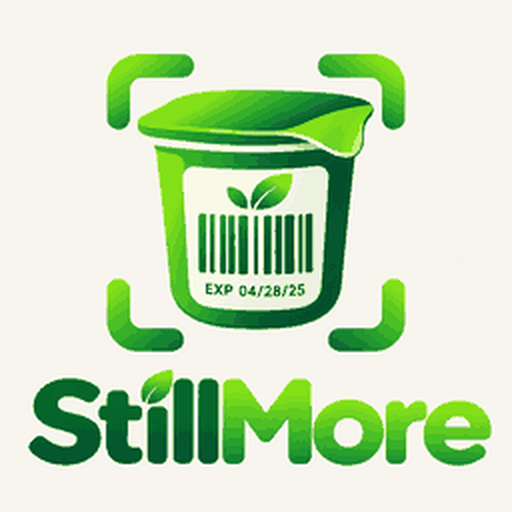
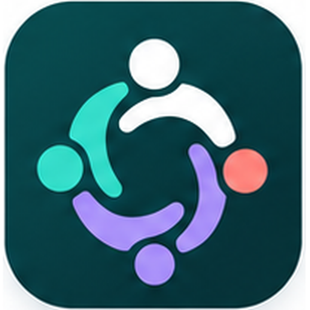

# Pixel Ledger

**Your everyday life. Connected.**

Welcome to Pixel Ledger, a collection of focused apps that give the details of everyday life a private place to belong. Each app is a personal ledger for a particular need, helping you keep useful information in order, see what needs attention and make more informed decisions. Start with the app that fits your day, keep control of what you record and build a clearer picture of your own life, one useful detail at a time.

## Explore the apps

<table><tr><td></td><td><h3>MYNVENTORY</h3> </td></tr>
<tr><td></td><td><h3>StillMore</h3> </td></tr>
<tr><td></td><td><h3>MONPATH</h3> </td></tr>
<tr><td></td><td><h3>MYCOMMIT</h3> </td></tr>
<tr><td></td><td><h3>WISHNEXT</h3> </td></tr>
<tr><td></td><td><h3>DOKIVAULT</h3> </td></tr>
<tr><td></td><td><h3>REALMILY</h3> </td></tr></table>

### More app stories coming soon

More Pixel Ledger apps will be introduced here, one at a time.

## Behind Pixel Ledger

I’m Emanuele Mendola. My path has taken me through management studies, big data management, consultancy, corporate analysis, change management and freelance work.

Pixel Ledger brings those experiences together through something tangible: identifying an everyday need, shaping a product around it and learning by building. AI/SI helps me build; I remain responsible for the decisions and what I put my name to.

For me, that is *mettersi in gioco*. Building my next chapter.

 [Find me on LinkedIn](https://linkedin.com/in/emanuele-mendola-460087254)

---

Emanuele Mendola / Pixel Ledger
