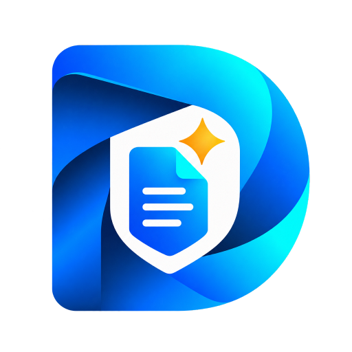
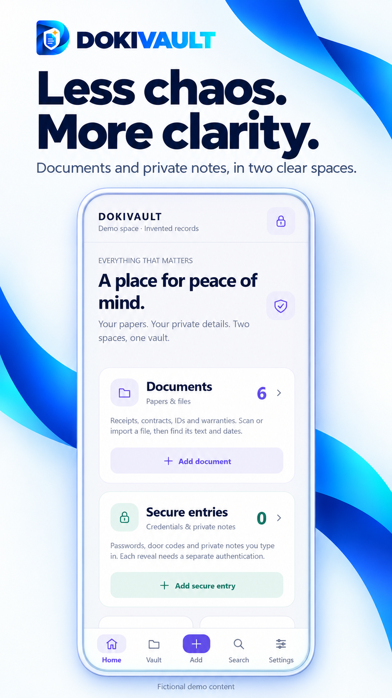
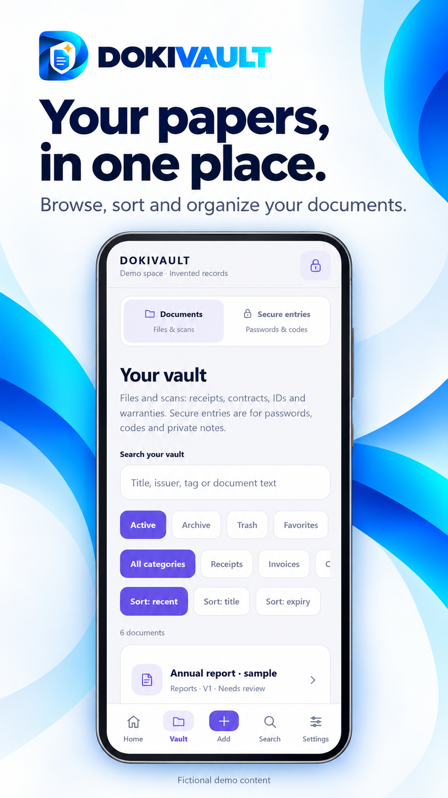
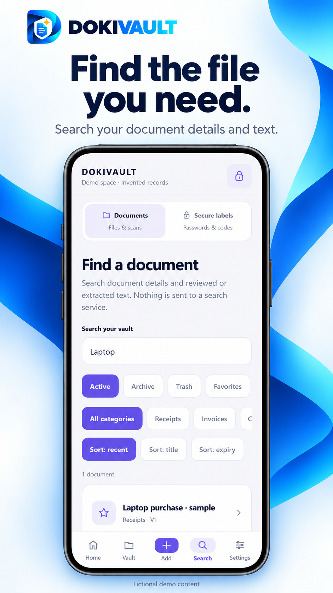
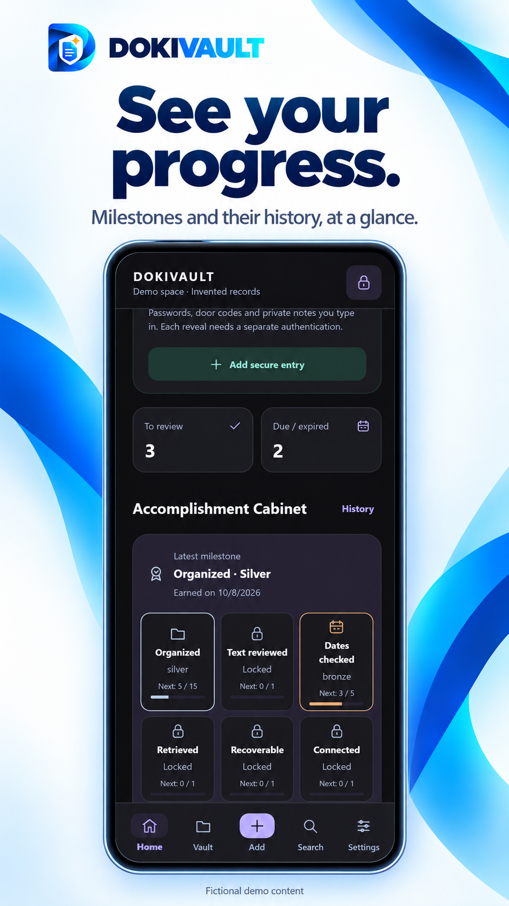

# DOKIVAULT

Give important information a clearer place.

A document-focused app for organising papers, finding files and keeping related information in view.

**Android only.**

## Start with the essentials

Bring the document-focused experience into a clear overview.

## Organise documents

Give papers and files a dedicated place in the experience.

## Find relevant information

Use the search view to locate document details and text.

## Recognise progress

See milestones within the document-organising experience.

## The thinking behind DOKIVAULT

By Emanuele Mendola

An important document becomes useful when you can find it at the moment it matters. That everyday need is the starting point for DOKIVAULT.

I wanted to keep the product focused on documents and the information around them. The views here show an overview, document organisation, search and progress.

My interest is in making the task understandable: where does this belong, and how will someone recognise it again? A clear experience should support those questions.

This portfolio shows the visible product experience through fictional demonstration content. It does not expose private documents or make a blanket claim about security or data handling.

[Privacy policy](https://pixelledger.dpdns.org/privacy/dokivault/)

## Privacy information

Privacy and security information belongs to this app. Please consult its app-specific privacy information before deciding what to record or share.

## Internal testing and developer review

DOKIVAULT has undergone internal testing and developer review, confirmed by Emanuele Mendola on 20 October 2026.

[Individual confirmations and comments](control-details.md)

Illustrations use demonstration records and figures, not private user data.

[Back to all apps](../README.md)
