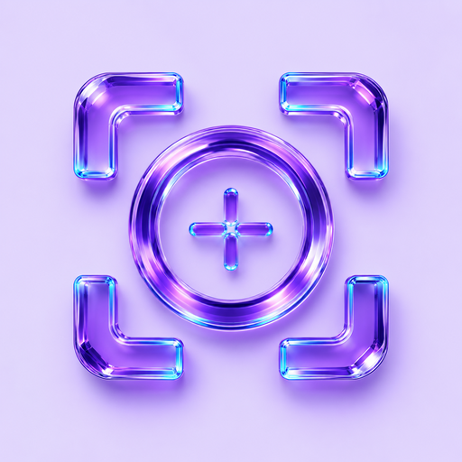
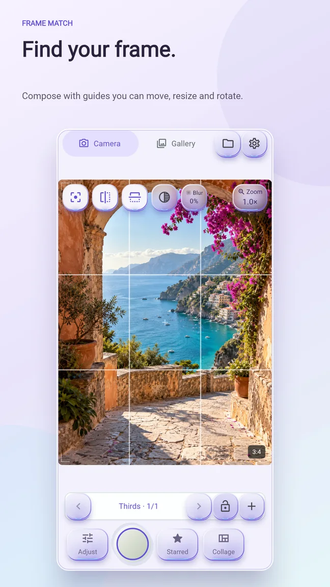
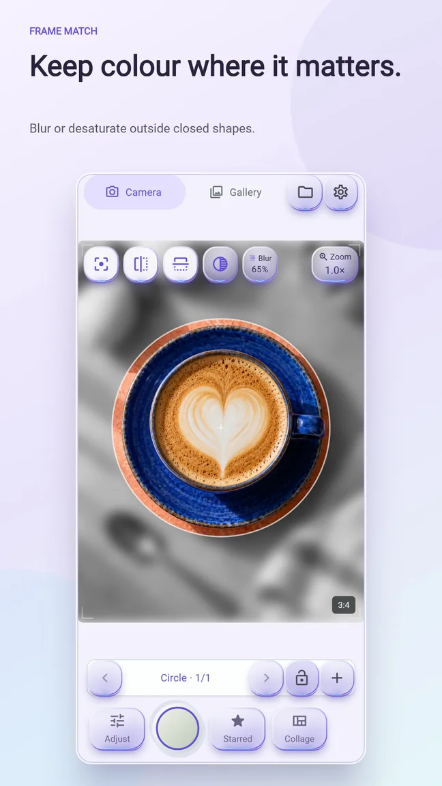
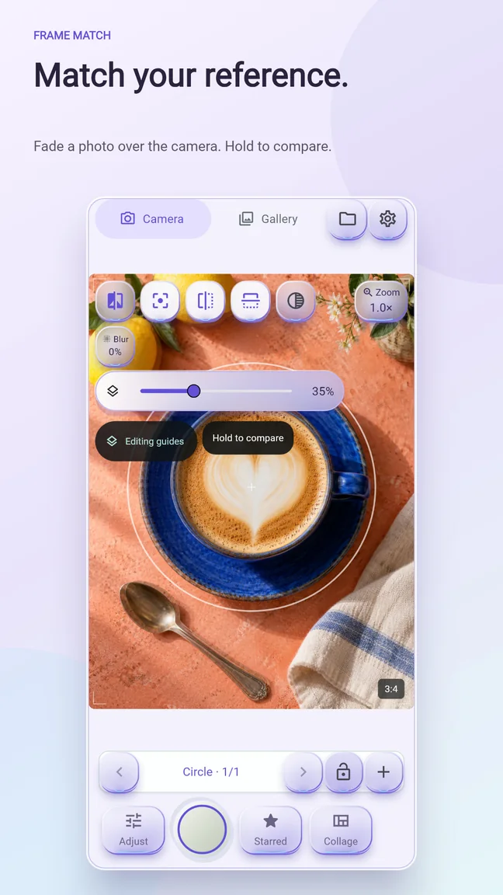
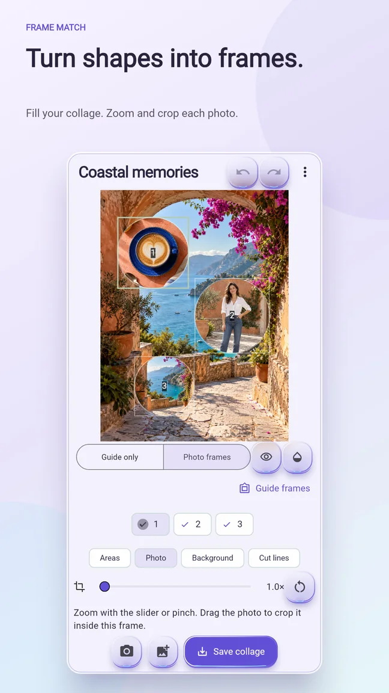
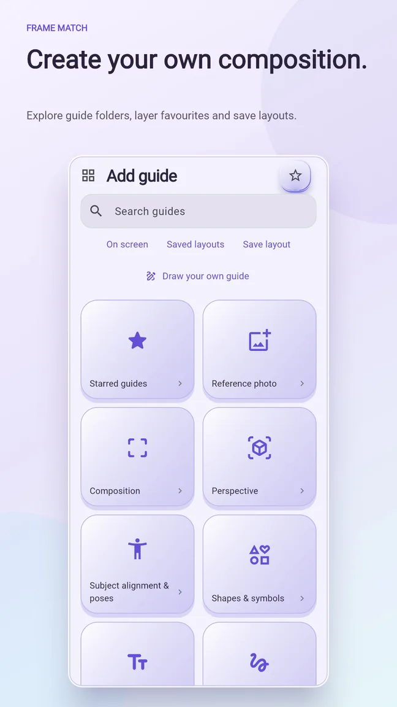
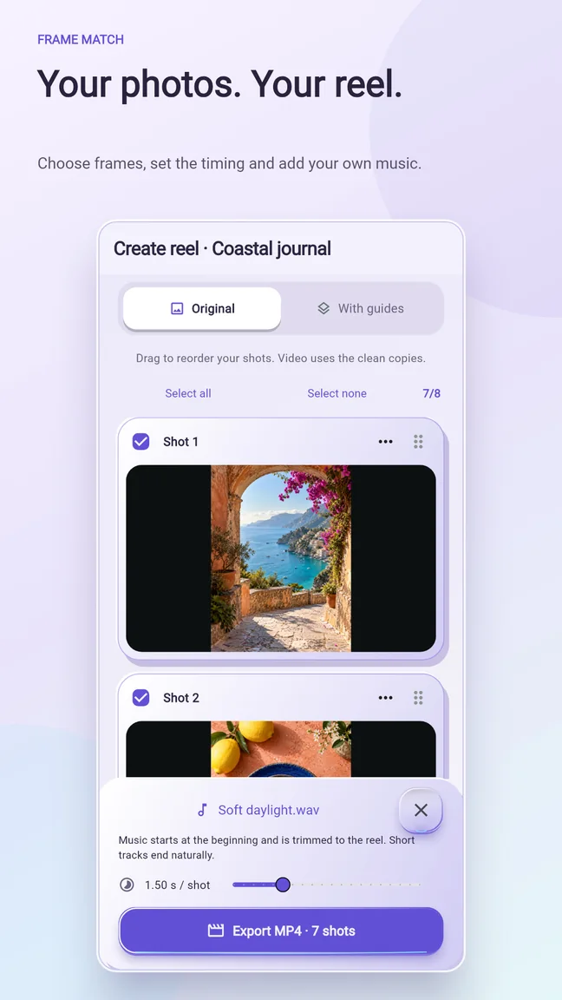
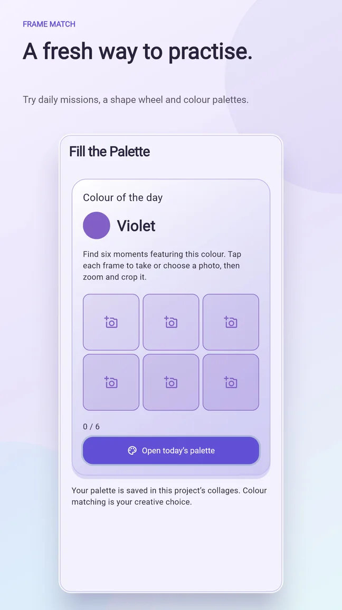
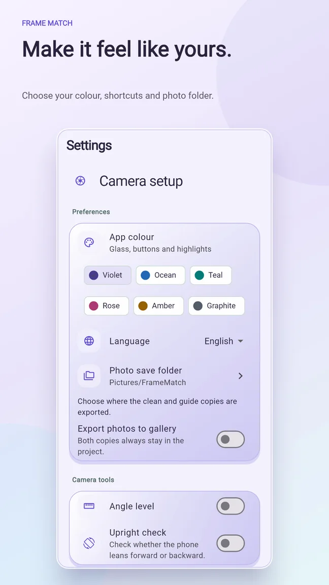

# Frame Match

## Frame your idea. Keep the alignment.

Compose photos with movable guides, reference overlays, selective effects and creative photo frames. Bring the results together in a matching reel.

Android. Google Play country and device compatibility determine availability.

[Product details](product-details.md) · [The thinking behind the app](story.md) · [Review and privacy](trust-details.md) · [Back to all apps](../README.md)

## Find your frame.

Move, resize, rotate or mirror composition guides. Combine favourites and save a layout when you want to repeat the same arrangement.

## Keep colour where it matters.

Use an eligible closed shape to keep the inside sharp and in colour while blurring or desaturating the outside. Keep a clean original alongside the enhanced copy.

## Match your reference.

Fade a reference photo over the camera, hold to compare and remove it directly when you are finished.

## Turn shapes into frames.

Fill eligible enclosed areas with photos. Zoom and drag each image to choose its crop.

## Build your composition.

Explore guide folders, combine guides and save layouts to reuse across a project.

## Your photos. Your reel.

Choose and arrange shots, set their timing and add music from your device before exporting a video.

## A fresh way to practise.

Try daily missions, customise the shape wheel and explore colour-palette challenges.

## Make it feel like yours.

Choose an accent colour, camera shortcuts and an export folder. The app includes illustrated offline tutorials in English and Italian.

## The thinking behind Frame Match

A photograph starts before the shutter. A reference, a line or a shape can help give an idea a place in the frame.

Frame Match keeps those visual choices in the camera workflow. A saved layout helps carry a composition across several photos; a reference overlay helps compare what you imagined with the scene in front of you.

The aim is to make composition something you can explore directly, from the first guide to a finished photo, collage or reel.

## Review and clear expectations

This page documents the existing mobile interface and the approved illustrated tutorials. It does not claim an independent audit or certification.

Real app interface with illustrative sample photos, including AI-generated images. Some controls may differ in newer versions.

## Get Frame Match

Android. Google Play country and device compatibility determine availability.

[Privacy policy](https://pixelledger.dpdns.org/privacy/frame-match/) · [Support](mailto:prazsky.ridic1@gmail.com) · [All app stories](../README.md)
