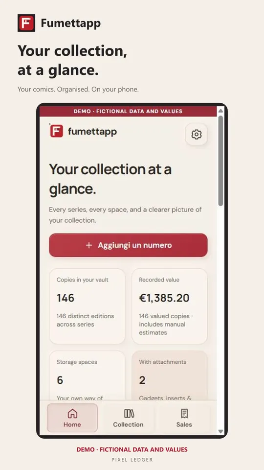
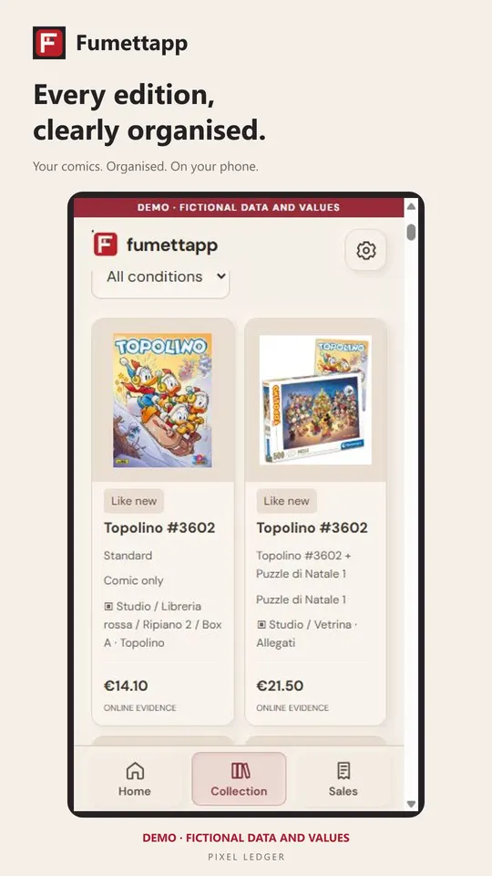
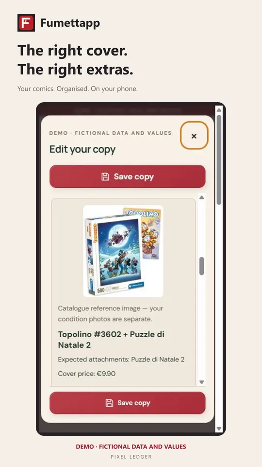
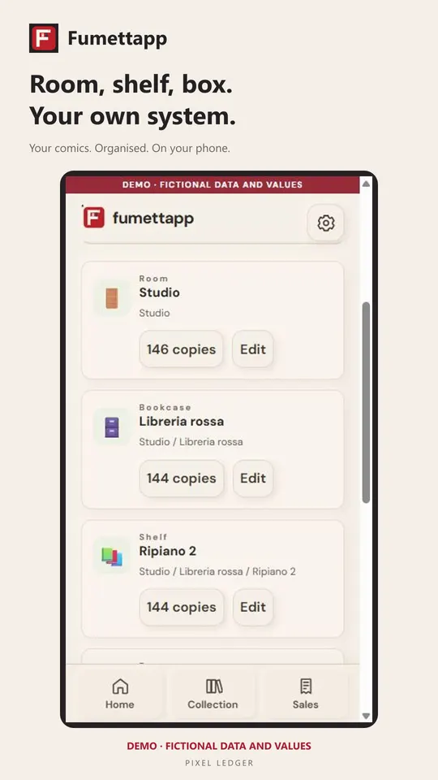
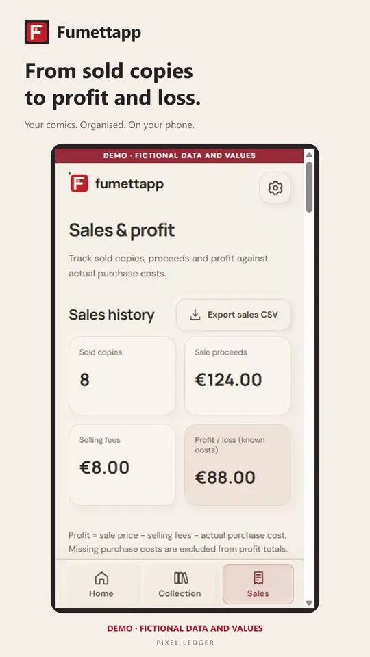
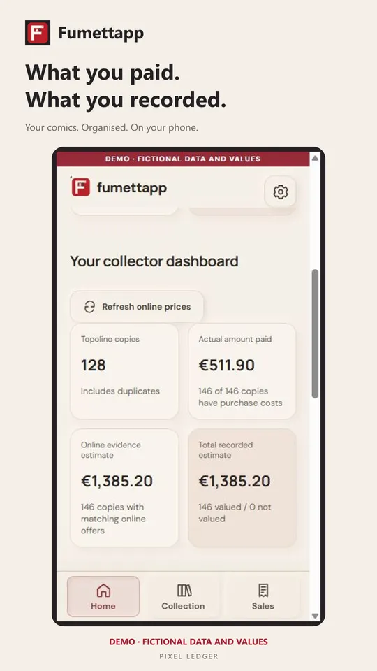

# Fumettapp

## Every comic in its place.

A personal comic collection ledger: distinguish editions and bundled extras, record where each copy belongs, and keep purchase, sale and valuation information in context.

Android, Italian and English. Google Play publication and subscription activation are being prepared; public download availability is not confirmed.

[Product details](product-details.md) · [The thinking behind the app](story.md) · [Review and privacy](trust-details.md) · [Back to all apps](../README.md)

## See the collection at a glance.

Return to a summary of the collection and the records you have entered.

## Give every copy a record.

Build a catalogue of the comics you own, with the details that distinguish one copy from another.

## Distinguish editions and extras.

Keep editions, inserts and bundled items visible alongside the comic they belong to.

## Know where to find it.

Record storage locations so you can return from a catalogue entry to the physical copy.

## Keep sales in context.

Maintain a record of copies offered or sold alongside your wider collection.

## Treat estimates as estimates.

Review available offers as supporting information. Illustrative prices are not verified market quotations or a guarantee of a sale.

## The thinking behind Fumettapp

A comic collection is made of individual copies. The edition, an accompanying insert and the shelf where a copy lives can matter as much as the title.

Fumettapp keeps those distinctions in a personal archive, bringing collection details, storage and sale records into the same picture.

Online searches can provide context, but they cannot promise a price. The collection remains the owner’s record, with exportable backups and deliberate decisions about what to keep or sell.

## Review and clear expectations

The screenshots are existing product presentation material. This page does not claim a completed independent security assessment, confirmed live purchasing or certification.

Demonstration records and prices are fictional. Fumettapp is independent of Disney, Panini and marketplaces and does not provide comics to read. Planned offer: 14 eligible trial days, then EUR 1.99/month; the actual offer is shown by Google Play. No automatic daily market checking or cloud sync is promised.

## Get Fumettapp

Android, Italian and English. Google Play publication and subscription activation are being prepared; public download availability is not confirmed.

[Privacy policy](https://pixelledger.dpdns.org/privacy/fumettapp/) · [Support](mailto:prazsky.ridic1@gmail.com) · [All app stories](../README.md)
