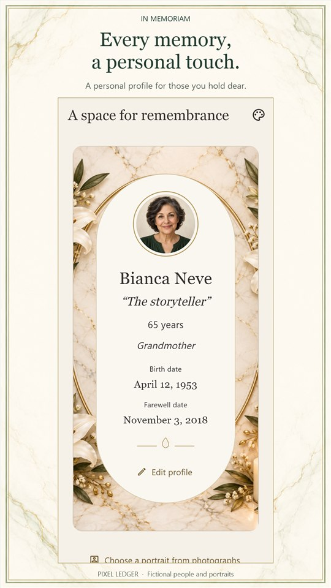
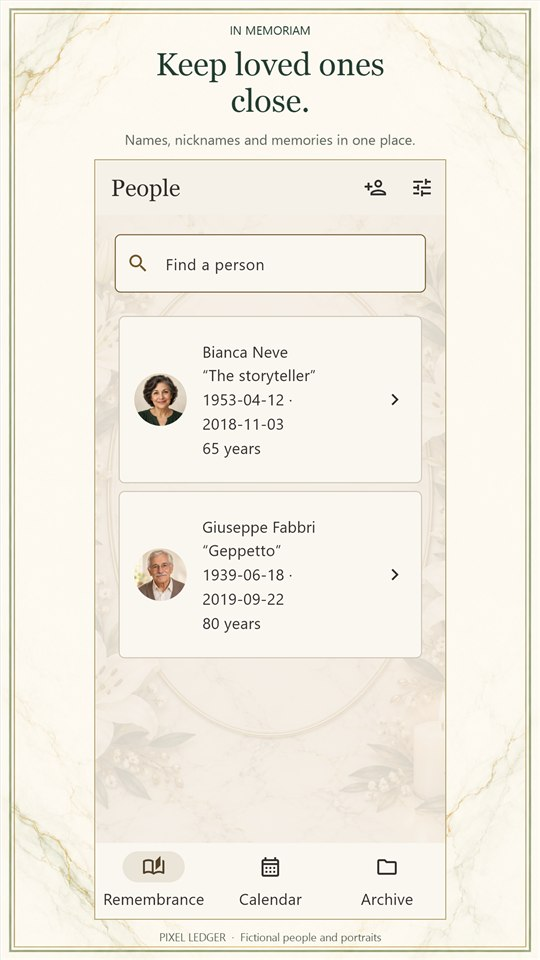
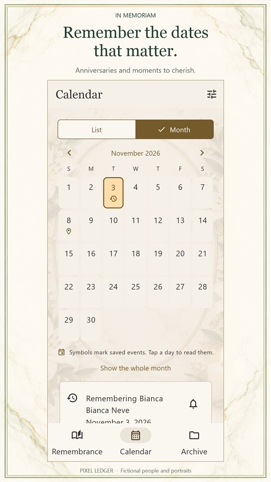
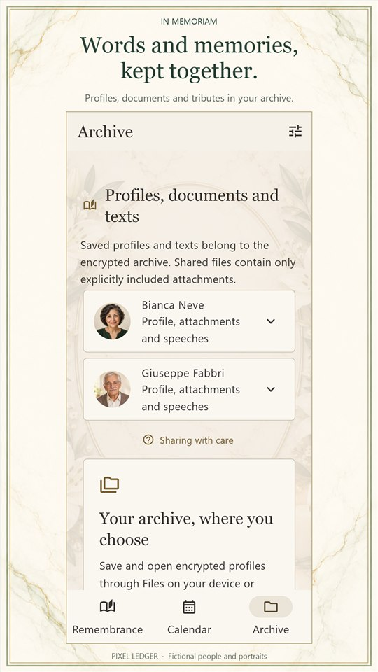

# IN MEMORIAM

## Memories have their own time.

Keep loved ones, meaningful dates, photographs and documents in a personal archive, with a theme for each person and sharing choices that remain yours.

Android release intended for Italy, in Italian and English. Production was submitted with managed publishing; public Google Play availability has not been independently confirmed for this page.

[Product details](product-details.md) · [The thinking behind the app](story.md) · [Review and privacy](trust-details.md) · [Back to all apps](../README.md)

## A personal profile.

Bring together a name, alias, portrait and information about a resting place. Choose a theme for the person, including a neutral presentation.

## Keep loved ones close.

Find the people recorded in your archive and return to the memories and details you have chosen to preserve.

## Dates to remember.

Keep anniversaries and personal dates in view. Local reminders require your confirmation and the phone’s notification permission.

## A personal archive.

Keep photographs, documents and written memories together. Export an encrypted archive and use the phone’s file services when you choose to share a copy.

## The thinking behind IN MEMORIAM

Remembering someone involves more than a date. A photograph, a familiar name or a place can hold a different part of their story.

IN MEMORIAM gives those details a quiet place together. Each person can have a distinct presentation, while the calendar and archive help you return to what matters.

Sharing remains a choice. An exported archive is a copy managed through the file service you select, rather than automatic collaboration or a promise that another person’s copy will change with yours.

## Optional ChatGPT connection

Choose which profiles to enable, look up selected names and dates, and review proposed profiles or reminders in the phone app. Nothing is shared automatically. A ChatGPT proposal is not yet a saved profile or a scheduled notification. Account access and the phone connection are separate requirements.

## Review and clear expectations

Development records include automated Flutter/MCP checks and phone testing. The optional ChatGPT connection requires explicit selection and approval. These are development checks, not independent certification.

All people, dates and portraits in these previews are fictional.

## Get IN MEMORIAM

Android release intended for Italy, in Italian and English. Production was submitted with managed publishing; public Google Play availability has not been independently confirmed for this page.

[Privacy policy](https://pixelledger.dpdns.org/privacy/in-memoriam/) · [Support](mailto:prazsky.ridic1@gmail.com) · [All app stories](../README.md)
