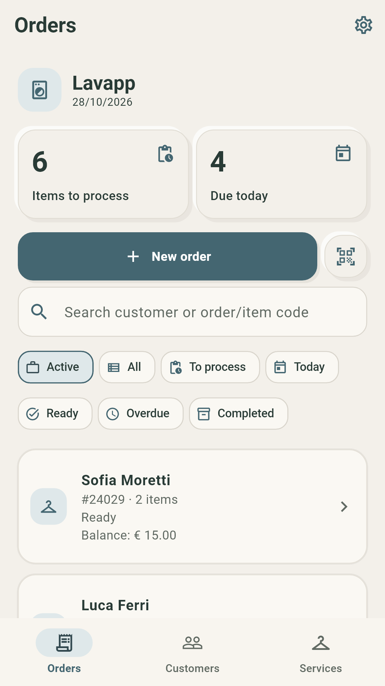
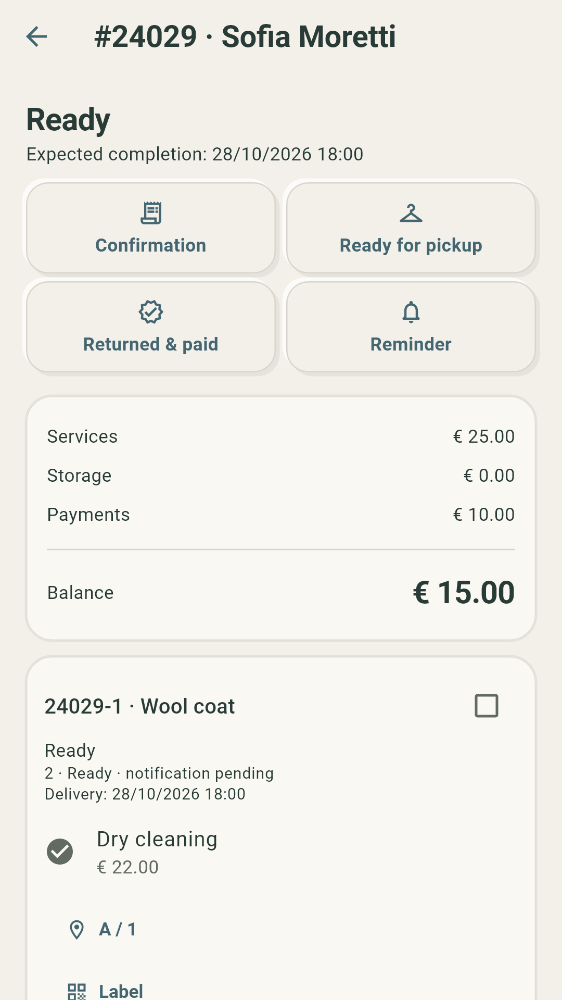
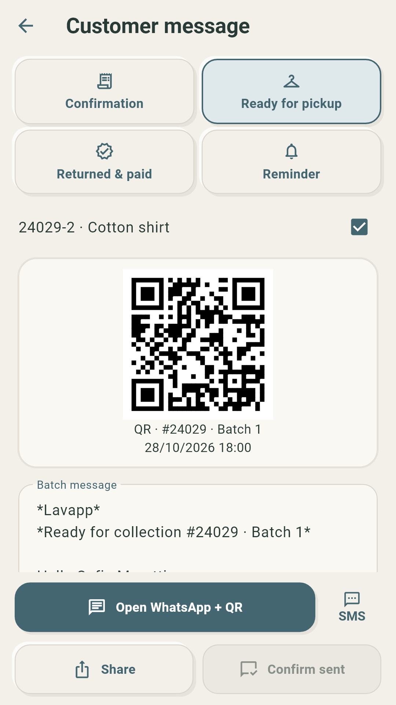
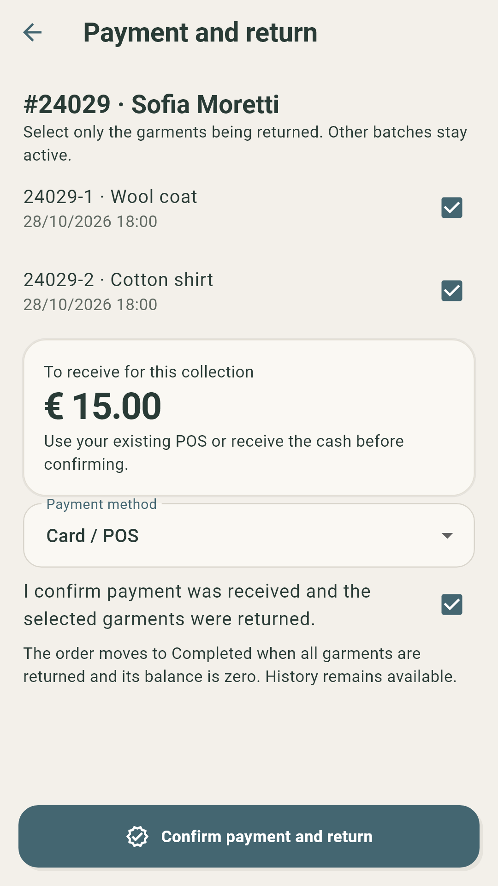
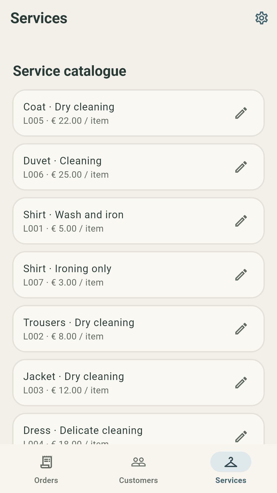
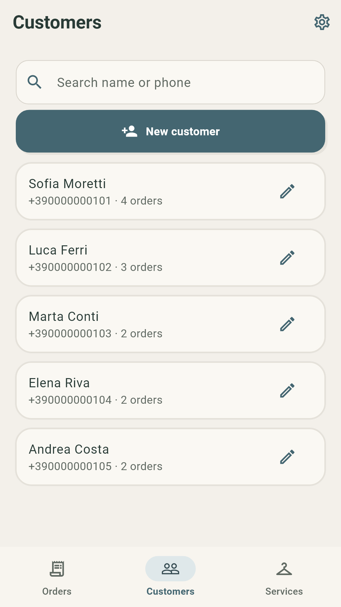

# Lavapp

## From intake to clean, ready and collected.

A phone-based order book for laundry and ironing shops: keep customers, garments, cleaning services, processing batches and pickup dates together.

Android, Italian and English. Version 0.8.3 was submitted for production review in Italy; public availability has not been independently confirmed for this page.

[Product details](product-details.md) · [The thinking behind the app](story.md) · [Review and privacy](trust-details.md) · [Back to all apps](../README.md)

## See the day’s work.

Review active orders, what still needs attention and the items due today.

## Start with the customer and the garments.

Choose an existing customer or add a new one. Record laundry and ironing services, quantities and separate promised pickup times for delivery batches.

## Prepare a clear pickup message.

Prepare a batch QR and message for WhatsApp, SMS or sharing. Review the recipient and send the message yourself; opening the composer does not mark it as sent.

## Record payment and return together.

Record cash or a successful payment through your existing POS, then confirm physical return. Partial collection leaves the other garments active. The app does not process charges.

## Keep your service menu useful.

Maintain your own prices, quantities and service alternatives. Import a menu from Excel or export the current one.

## Keep the customer history.

Return to contact details, previous work and collection information without losing the history of completed orders.

## The thinking behind Lavapp

A laundry and ironing shop needs to keep several promises at once: what arrived, what work was requested, when it will be ready and what has already been paid.

Lavapp follows that journey from the counter to collection. Garment references and delivery batches help the merchant keep each item connected to its customer and promised time.

The phone prepares the record and the message; the merchant remains responsible for sending notices, receiving payments and confirming that the garments have actually been returned.

## Review and clear expectations

Release records report static analysis, 71 Flutter tests, signed-build and 16 KB compatibility checks, plus phone verification of checkout-error recovery. Successful purchase and restoration testing remained pending in those records. This is not an independent audit or certification.

Screenshots use fictional customer and order data. Eligible accounts: planned 7-day free trial, then EUR 19.99/month per app, automatically renewing unless cancelled. Google Play displays current price and eligibility before purchase. PDF summaries do not replace Italian electronic invoicing through SdI.

## Get Lavapp

Android, Italian and English. Version 0.8.3 was submitted for production review in Italy; public availability has not been independently confirmed for this page.

[Privacy policy](https://pixelledger.dpdns.org/privacy/lavapp/) · [Support](mailto:prazsky.ridic1@gmail.com) · [All app stories](../README.md)
