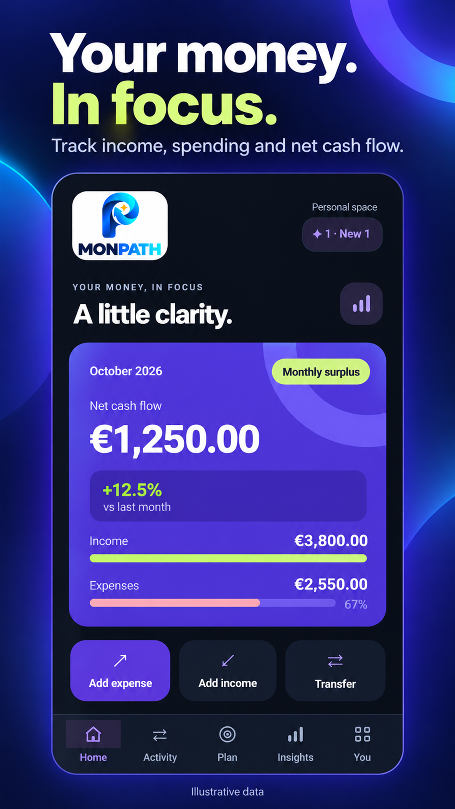
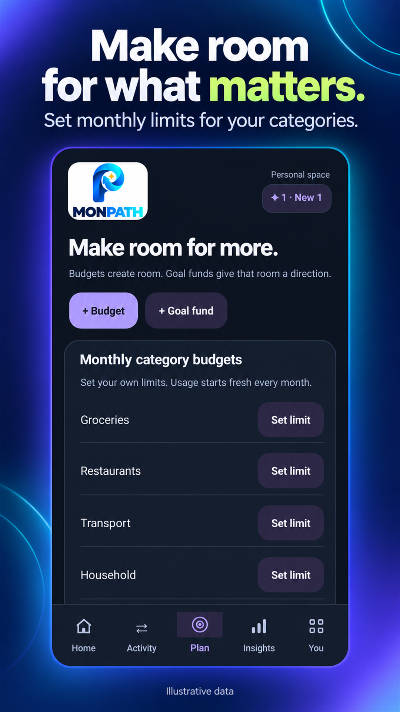
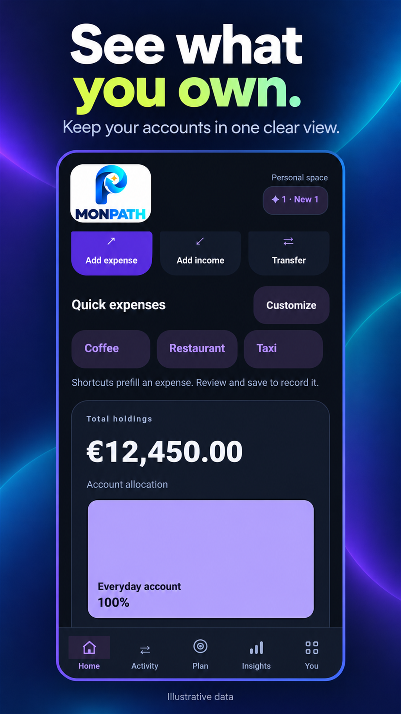
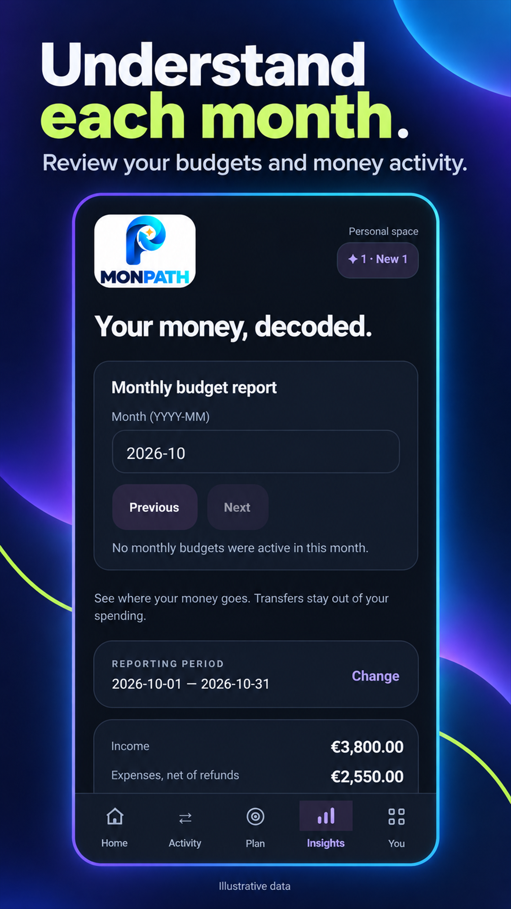

# MONPATH

Your money, in focus.

A focused place for personal budgeting, financial goals and a clearer view of everyday money.

**Android only.**

## See the overall picture

Bring income, spending and net cash flow into the same view.

## Give categories a budget

Set monthly limits for the categories that matter to your everyday life.

## Keep accounts in view

Review holdings and account allocation in a dedicated overview.

## Look back at the month

Review budget information and money activity together.

## The thinking behind MONPATH

By Emanuele Mendola

Money decisions become harder to follow when the information is scattered. With MONPATH, I wanted to give that everyday task a clear focus.

My background in analysis makes me interested in the relationship between a number and the decision it helps someone make. Income, spending and budgets are useful when they help a person understand their own situation.

The views shown here approach that from different angles: the overall picture, category budgets, accounts and a monthly review. The figures are illustrative, not financial results or promises.

For me, this project brings product judgement into a familiar analytical setting. I want the experience to make the information understandable without pretending to make the decisions for someone.

[Privacy policy](https://pixelledger.dpdns.org/privacy/monpath/)

## Privacy information

Privacy and security information belongs to this app. Please consult its app-specific privacy information before deciding what to record or share.

## Internal testing and developer review

MONPATH has undergone internal testing and developer review, confirmed by Emanuele Mendola on 20 October 2026.

[Individual confirmations and comments](control-details.md)

Illustrations use demonstration records and figures, not private user data.

[Back to all apps](../README.md)
