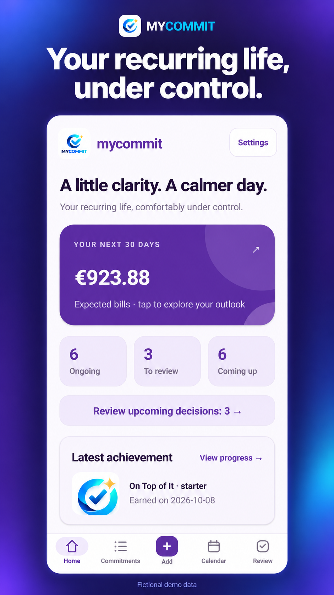
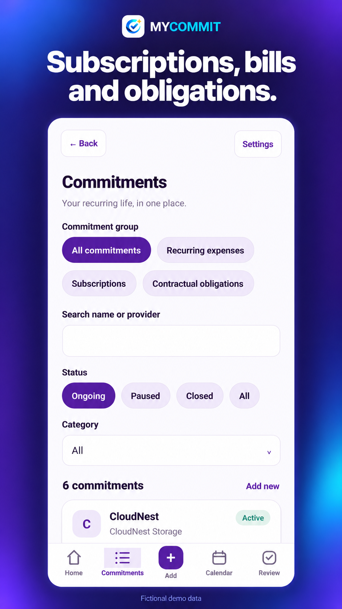
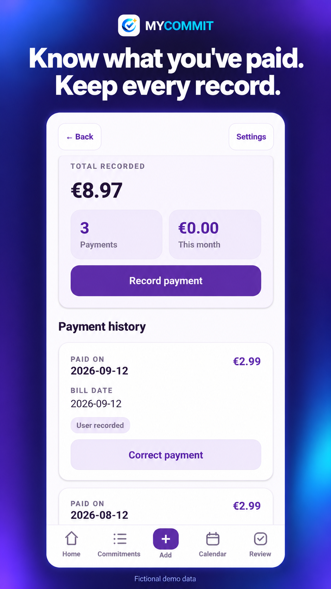
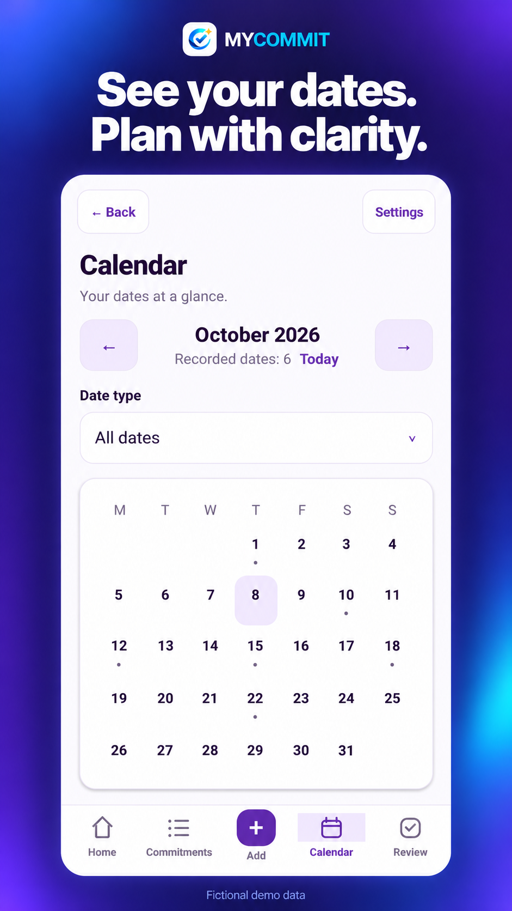
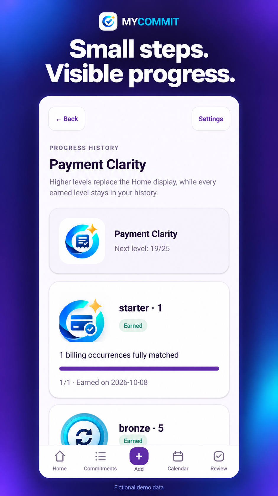

# MYCOMMIT

A clearer view of recurring responsibilities.

A dedicated place for commitments, subscriptions, bills and the information around their dates and payments.

**Android only.**

## See the commitments together

Keep subscriptions, bills and obligations in a focused view.

## Review recorded payments

Look back at payment records and their dates.

## Make dates visible

Use a calendar view to review the timing around commitments.

## Recognise the small steps

Review achievement history and visible progress within the experience.

## The thinking behind MYCOMMIT

By Emanuele Mendola

A commitment is more than something to tick off today. It can involve a date, a payment, a renewal and a decision that comes around again.

That is why I wanted MYCOMMIT to have a clear purpose. Subscriptions, bills and obligations deserve an experience that keeps their context visible.

The views shown here focus on commitments, recorded payments and dates. Together they explain the task more clearly than a generic to-do list.

For me, the product question is how to help someone stay oriented without making the experience heavier than the responsibility itself. The records and amounts in these images are fictional demonstration data.

[Privacy policy](https://pixelledger.dpdns.org/privacy/mycommit/)

## Privacy information

Privacy and security information belongs to this app. Please consult its app-specific privacy information before deciding what to record or share.

## Internal testing and developer review

MYCOMMIT has undergone internal testing and developer review, confirmed by Emanuele Mendola on 20 October 2026.

[Individual confirmations and comments](control-details.md)

Illustrations use demonstration records and figures, not private user data.

[Back to all apps](../README.md)
