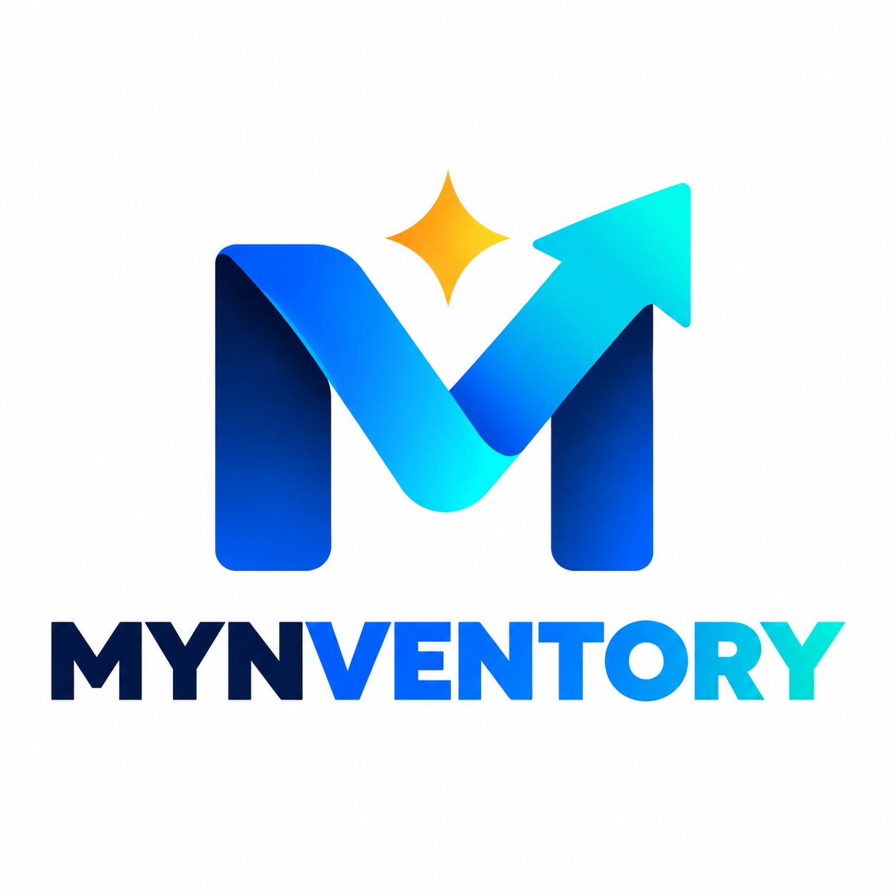
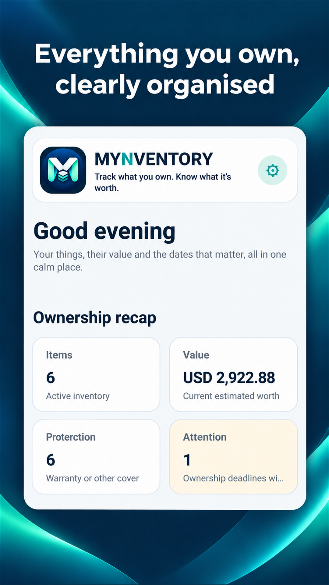
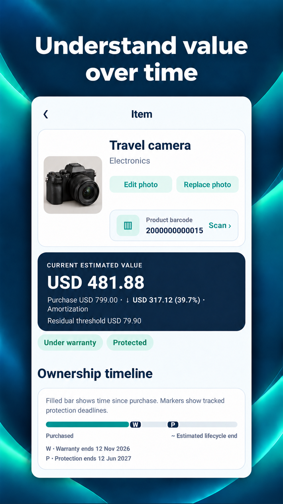
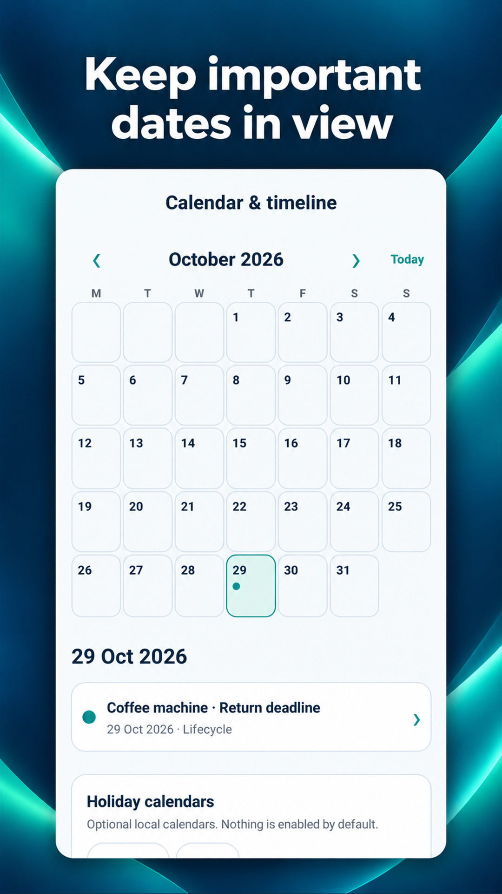
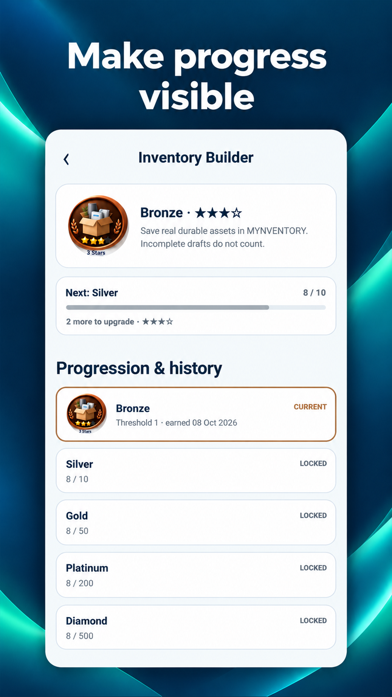
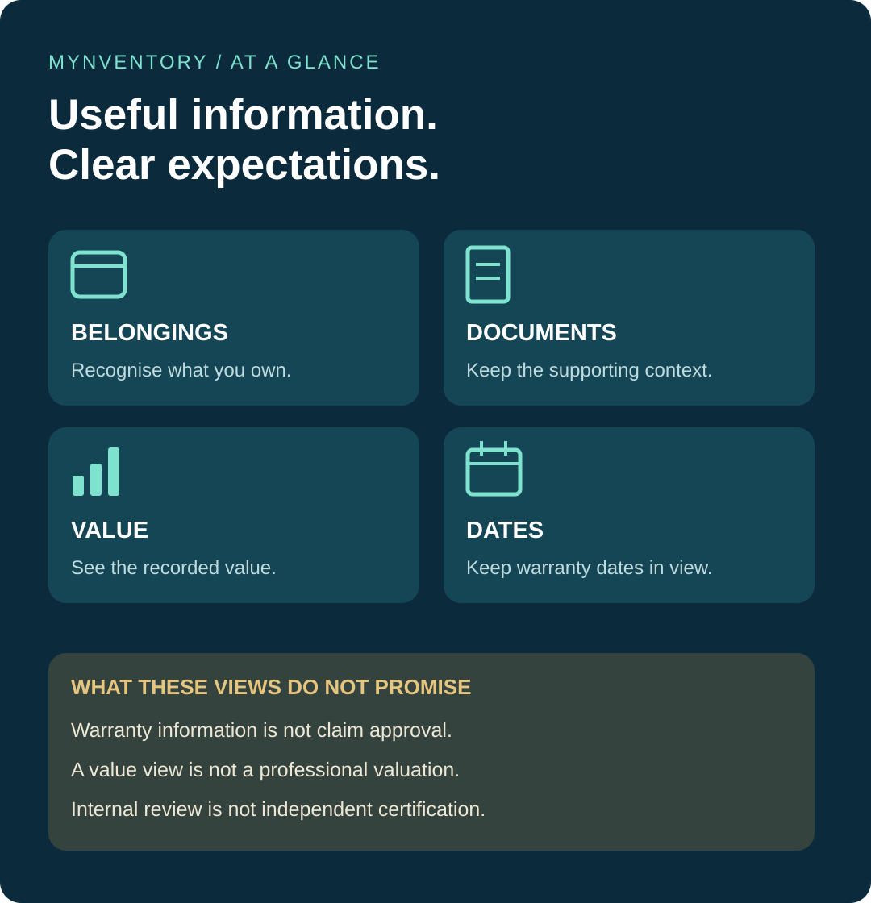
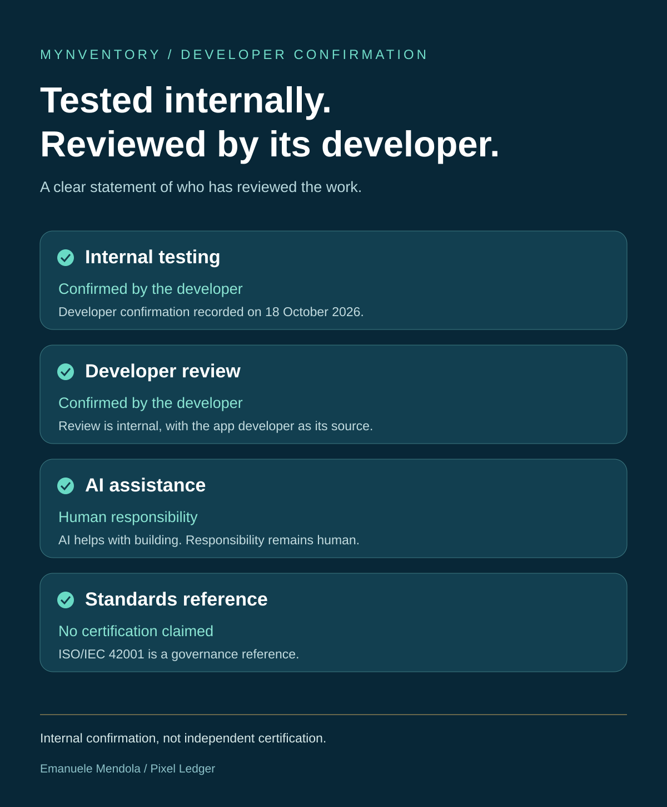

# MYNVENTORY

## [Get MYNVENTORY on Google Play](https://play.google.com/store/apps/details?id=cz.prazskyridic.mynventory)

**Android only, for now.**

The story behind what you own: belongings, their value, their documents and the dates that matter.

[My story](#building-my-next-chapter) · [Product views](product-details.md) · [Visual guide](visual-guide.md) · [Developer review](trust-details.md) · [Confirmations](control-details.md) · [Sources](sources.md)

## A clearer view of what you own.

The ownership overview brings items, value and protection into one view.

## Start with the belonging.

A visual inventory gives each item a recognisable place.

## Keep value in context.

Explore the item details and value view shown in the store artwork.

## Keep the proof close.

Receipts and supporting documents belong in the ownership story.

## Give important dates a place.

Dates and warranties bring a timeline to the things you own.

## Make progress visible.

The achievements screen is another part of the documented app experience.

## The information around a belonging

## Building my next chapter

BY EMANUELE MENDOLA

My path has taken me through management and big data studies, consultancy, corporate analysis, change management and freelance work. Each experience has added something to the way I look at work and the people doing it.

With generative AI advancing so quickly, I wanted to get involved through something tangible. I wanted more than familiarity with the conversation. I wanted a project I could put my name to.

MYNVENTORY is part of that next chapter.

### The information around a belonging

A camera is more than an item on a shelf. It has a purchase behind it, documents that may matter later, a value and perhaps a warranty date to remember.

The same can be true of headphones, a laptop or something else we use every day. Remembering that we own it is one thing. Finding the information when we need it is another.

That is the everyday context MYNVENTORY brings into focus: belongings and the information around them. The product views here show that idea through inventory, documents, value and dates.

### Something I can put my name to

This project brings my different hats together. My background is part of it, and so is the willingness to become a learner again.

AI has helped me build. It has not replaced my responsibility for what I present. I have confirmed internal testing and developer review as part of this work. That is the basis of the review statement shared here.

What matters to me is having something tangible to show and a useful purpose to explain. It gives me a way to share my work beyond a job title or a list of skills.

For me, that is mettersi in gioco. Building my next chapter, and being willing to put the result in front of people.

[Explore the ownership views](product-details.md) · [Read my internal review statement](trust-details.md)

## MYNVENTORY at a glance

[Explore the product views](product-details.md) · [Supporting trust details](trust-details.md)

## Internal testing and developer review

[Review scope](trust-details.md) · [Individual confirmations](control-details.md) · [Sources and reference frameworks](sources.md)

## Download MYNVENTORY

[Get MYNVENTORY on Google Play](https://play.google.com/store/apps/details?id=cz.prazskyridic.mynventory)

**Android only, for now.**

[Privacy policy](https://pixelledger.dpdns.org/privacy/mynventory/)
