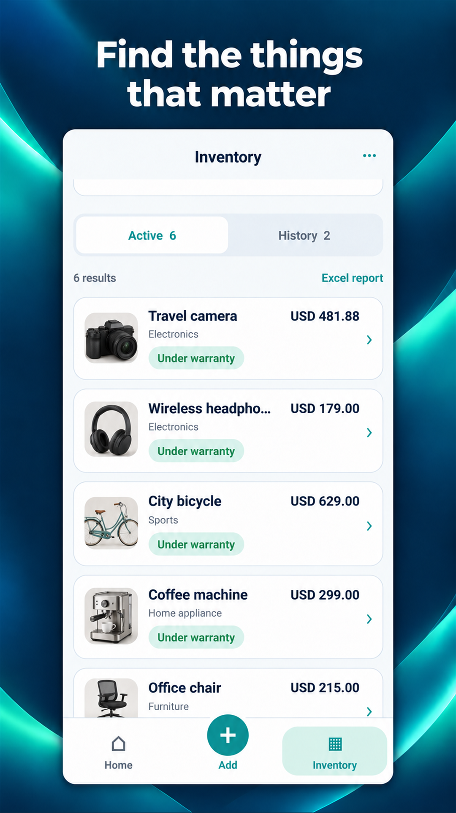
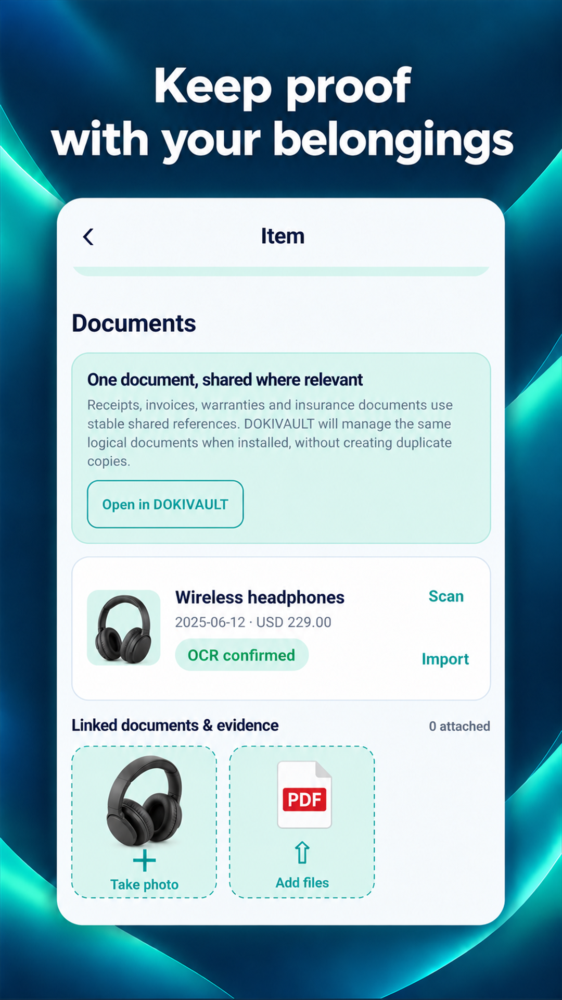
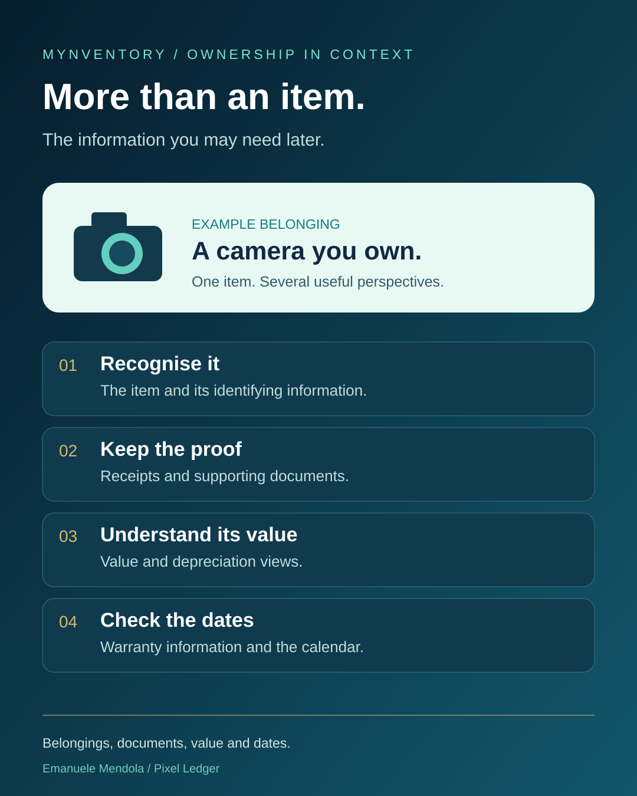

# A visual guide to ownership

The app story is easiest to understand through the item, its information and the dates around it.

[The belonging](README.md#visual-02)

[The supporting information](README.md#visual-04)

[Internal testing and developer review](trust-details.md) · [My story](blog.md)

[Back to MYNVENTORY](README.md) · [Google Play for Android](https://play.google.com/store/apps/details?id=cz.prazskyridic.mynventory)
