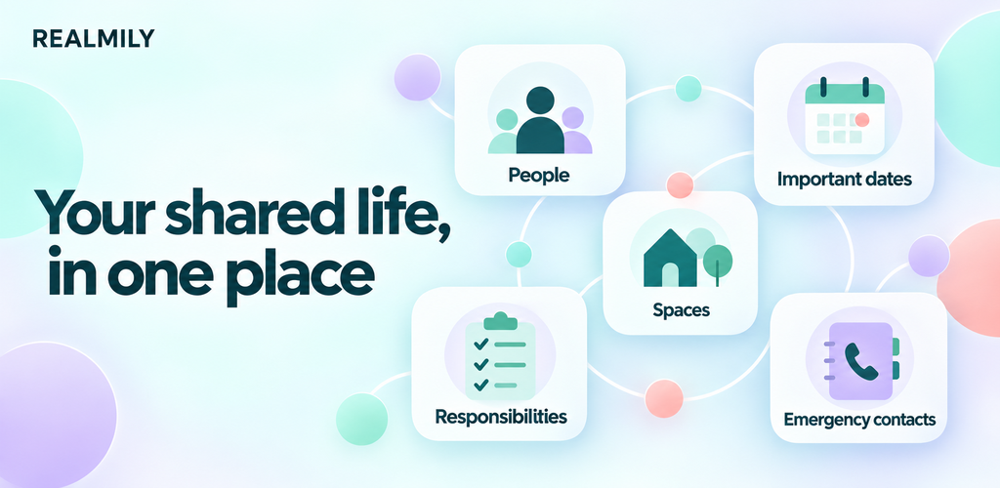
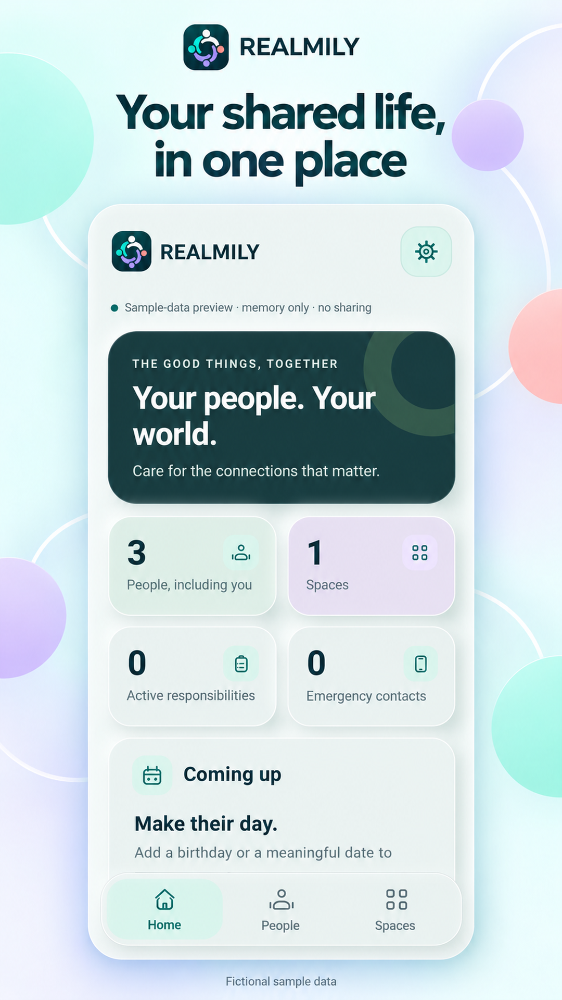
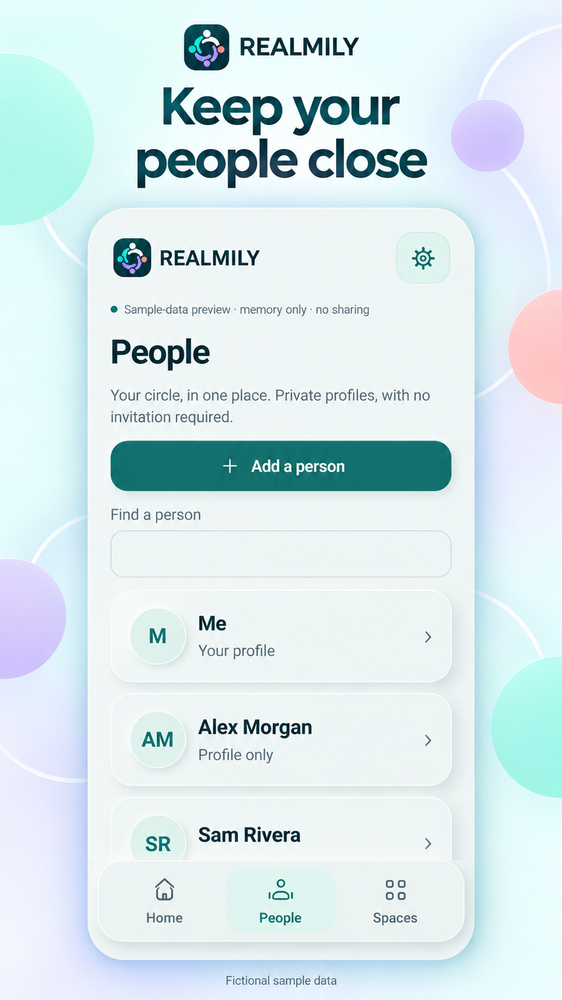
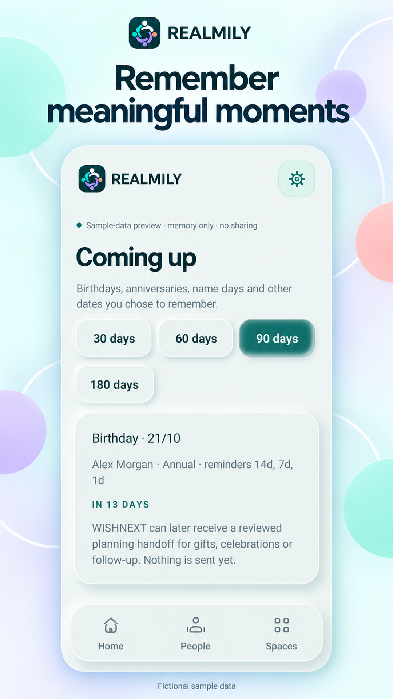
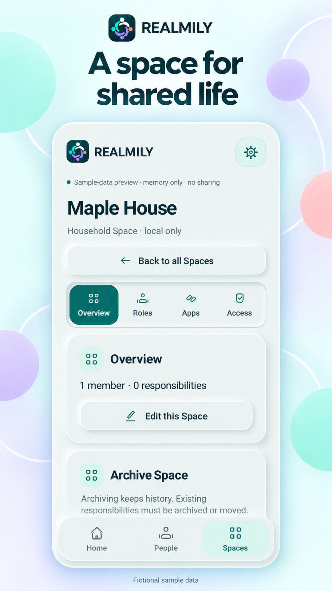

# REALMILY

A place for people and shared spaces.

An everyday organiser focused on people, spaces and meaningful moments.

**Android only.**

## Start with an overview

Bring the people-and-spaces view of everyday life into focus.

## Keep people in mind

Give the people in your everyday life a dedicated place in the experience.

## See what is coming up

Review meaningful moments in the coming-up view.

## Give spaces their context

Explore the space view alongside the people-related parts of everyday life.

## The thinking behind REALMILY

By Emanuele Mendola

Some everyday information makes more sense when it starts with a person or a space. That is the perspective behind REALMILY.

I wanted to give those relationships a place in the experience, rather than treat everything as an isolated task. The views here move between an overview, people, meaningful moments and spaces.

My experience in change management keeps bringing me back to how a product feels to the person using it. Information needs to be understandable in the context of their life.

The people and situations shown here are fictional examples. The story is about organising the context around everyday life, without making promises about live sharing or automatic reminders.

[Privacy policy](https://pixelledger.dpdns.org/privacy/realmily/)

## Privacy information

Privacy and security information belongs to this app. Please consult its app-specific privacy information before deciding what to record or share.

## Internal testing and developer review

REALMILY has undergone internal testing and developer review, confirmed by Emanuele Mendola on 20 October 2026.

[Individual confirmations and comments](control-details.md)

Illustrations use demonstration records and figures, not private user data.

[Back to all apps](../README.md)
