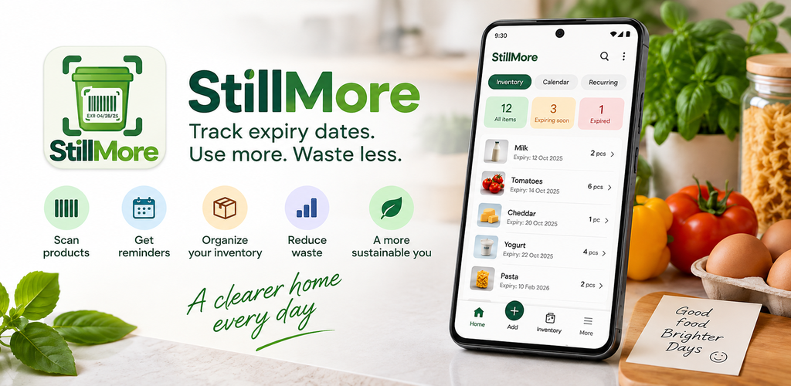

# StillMore

Pay attention to what you can use next.

A dedicated app for keeping track of expiring supplies, with food approaching expiry at the centre of its everyday story.

**Android only.**

## Keep expiry dates in view

The inventory presentation puts expiry-related information alongside everyday supplies.

## Organise what is already there

Give the supplies at home a focused inventory view.

## Recognise what needs attention

The illustrated overview separates all items, expiring-soon items and expired items.

## Start with a useful question

What could I use next from what is already here? The app keeps that need at the centre of its purpose.

## The thinking behind StillMore

By Emanuele Mendola

Food approaching expiry asks a practical question: what could I use next from what is already here? I wanted StillMore to give that need a clear focus.

That perspective is different from keeping a record of long-lived belongings. The timing matters in a different way, and the experience should reflect it.

The existing visual introduces an inventory organised around supplies and expiry information. It is an explanation of the product purpose, not evidence that an app can determine whether food is safe.

For me, the useful product question is whether the next decision becomes easier to understand. That is the kind of clarity I want to keep reviewing as the experience develops.

[Privacy policy](https://pixelledger.dpdns.org/privacy/stillmore/)

## Privacy information

Privacy and security information belongs to this app. Please consult its app-specific privacy information before deciding what to record or share.

## Internal testing and developer review

StillMore has undergone internal testing and developer review, confirmed by Emanuele Mendola on 20 October 2026.

[Individual confirmations and comments](control-details.md)

## ChatGPT plugin

StillMore now has a ChatGPT plugin for planning meals from connected inventory, preparing shopping lists and reviewing proposed stock updates. Inventory changes require approval in StillMore. The plugin service has been deployed; the production Android connection flow and end-to-end pairing are still being verified.

Illustrations use demonstration records and figures, not private user data.

[Back to all apps](../README.md)
