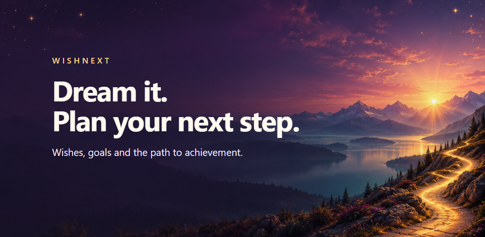
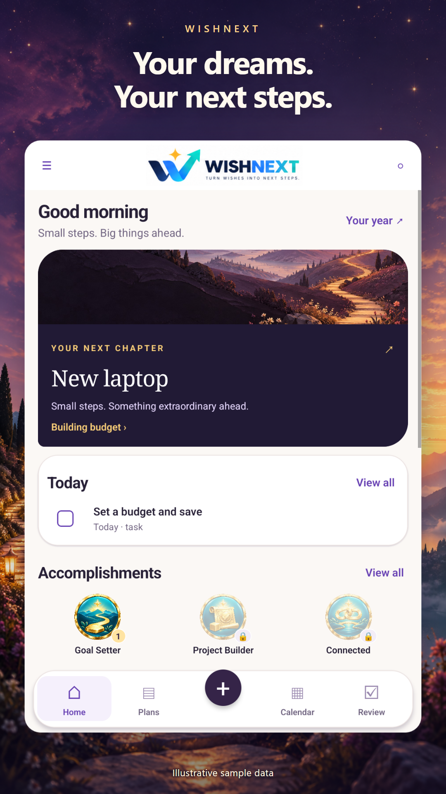
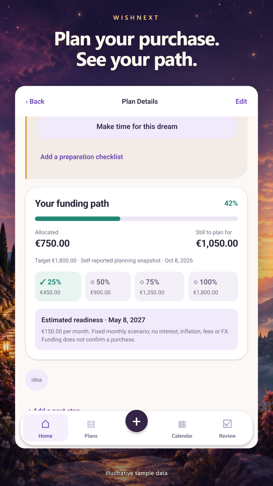
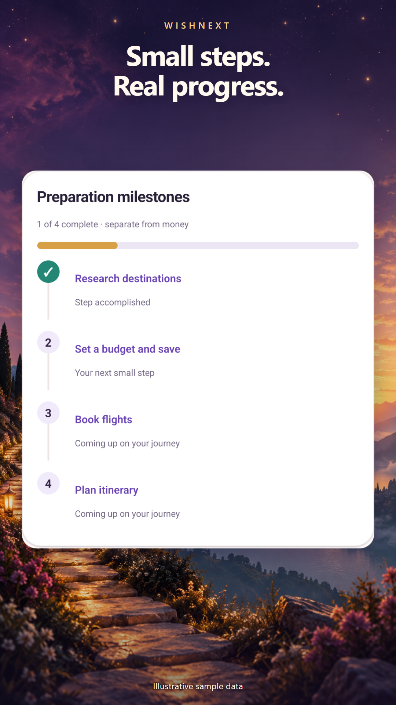
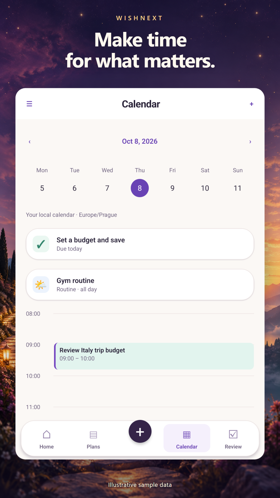
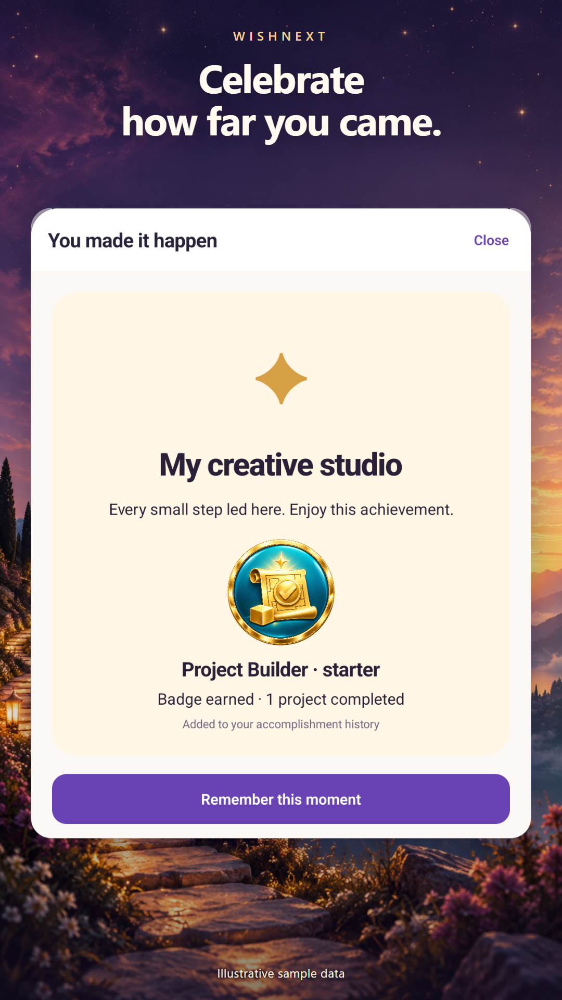

# WISHNEXT

Give your next idea somewhere to grow.

A focused place for wishes, plans and the steps that turn an intention into something you can work towards.

**Android only.**

## Keep plans in view

See a wish or project alongside its next task.

## Consider the budget

Review allocated funding, milestones and a contribution-based readiness forecast.

## Make the next step concrete

Break a plan into preparation steps you can work through.

## Give the plan time

See tasks, routines and time blocks in a calendar view.

## Recognise progress

Mark a completed project and take time for reflection.

## The thinking behind WISHNEXT

By Emanuele Mendola

An idea can feel clear until it is time to decide what to do next. I wanted WISHNEXT to give that moment some structure.

A wish and a practical plan can belong in the same conversation. The examples here connect an intention with preparation steps, budget considerations and time.

The project interests me because progress is rarely one large decision. It is often a sequence of smaller choices that need somewhere to stay visible.

I want the experience to support that movement while leaving the meaning of the goal with the person pursuing it. The plans and figures in these images are fictional examples.

[Privacy policy](https://pixelledger.dpdns.org/privacy/wishnext/)

## Privacy information

Privacy and security information belongs to this app. Please consult its app-specific privacy information before deciding what to record or share.

## Internal testing and developer review

WISHNEXT has undergone internal testing and developer review, confirmed by Emanuele Mendola on 20 October 2026.

[Individual confirmations and comments](control-details.md)

Illustrations use demonstration records and figures, not private user data.

[Back to all apps](../README.md)
